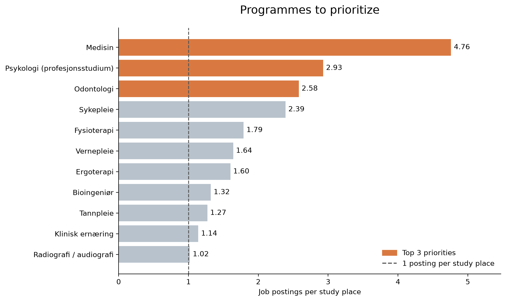
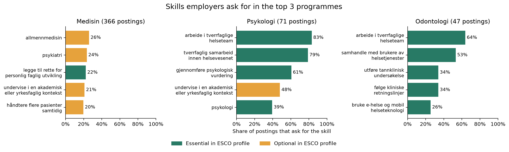
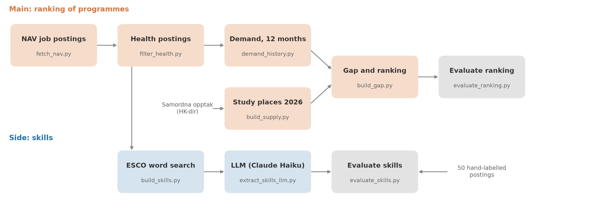
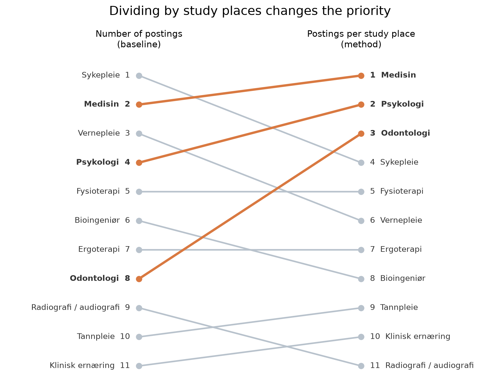

# mind-the-gap

Which health programmes should Norway prioritise to meet employer demand?

We compare job postings from NAV (demand) with study places in Samordna opptak
2026 (supply) for health professions that need a higher education degree. We
also find which skills employers ask for, using the ESCO skills list.

**Answer so far:** Medisin, Psykologi and Odontologi have the most job postings
per study place. Ranking by the number of postings alone would instead put
Sykepleie first, because it is the largest programme.

## Results

### Which programmes to prioritise

Job postings in the last 12 months per study place in 2026
(`data/processed/gap_by_programme.csv`). Every programme has more than one
posting per study place.



| Rank | Programme | Postings | Study places | Postings per place | First-choice applicants per place |
|---|---|---|---|---|---|
| 1 | Medisin | 4 280 | 900 | **4.76** | 4.33 |
| 2 | Psykologi (profesjonsstudium) | 1 353 | 462 | **2.93** | 12.76 |
| 3 | Odontologi | 420 | 163 | **2.58** | 4.57 |
| 4 | Sykepleie | 13 482 | 5 630 | 2.39 | 2.34 |
| 5 | Fysioterapi | 824 | 460 | 1.79 | 5.71 |
| 6 | Vernepleie | 1 960 | 1 195 | 1.64 | 2.37 |
| 7 | Ergoterapi | 474 | 297 | 1.60 | 1.86 |
| 8 | Bioingeniør | 562 | 427 | 1.32 | 2.50 |
| 9 | Tannpleie | 140 | 110 | 1.27 | 4.07 |
| 10 | Klinisk ernæring | 105 | 92 | 1.14 | 1.75 |
| 11 | Radiografi / audiografi | 235 | 230 | 1.02 | 4.94 |

- **Medisin** has almost five postings per study place, clearly more than any
  other programme (next is Psykologi with 2.9).
- **Psykologi** has 12.8 first-choice applicants per place, so more places
  would be easy to fill.
- **Sykepleie** has by far the most postings, but it also has the most study
  places, so it comes fourth.

### Which skills employers ask for in the top 3

The skills that ESCO lists for the occupation (essential or optional) and that
the postings ask for most often, found by the LLM method
(`data/processed/skills_by_programme_llm.csv`). The percentage is the share of
current postings that ask for the skill. Green is essential in the ESCO
profile, yellow is optional. Made in `notebooks/02_study_places_prioritized.ipynb`.



- **Medisin** postings ask for a specialty (general practice, psychiatry,
  emergency medicine), so no single skill is in more than about a quarter of
  them.
- **Psykologi** and **Odontologi** postings ask for working in teams with
  other health professions more than anything specific to the subject.
- General skills that are not in the ESCO profiles come first for all three:
  *norsk* is in 80–92 % of the postings and *kommunikasjon* in 70–79 %. New
  study places should keep these in the programme, but they do not tell the
  programmes apart.

Psykologi and Odontologi have few current postings, so their percentages are
uncertain. The full table for all programmes, including skills outside the
ESCO profile, is in `skills_by_programme_llm.csv`.

## Quickstart

All data is already in the repo, so you don't need to download anything.

```bash
pip install -r requirements.txt
python src/build_gap.py           # prints the ranking of programmes
python src/evaluate_ranking.py    # compares the ranking with the baseline
```

The results are saved as CSV files in `data/processed/` and `data/eval/`.

## Folders

| Folder | Contents |
|---|---|
| `src/` | the scripts. Each one says at the top what it reads and writes |
| `data/raw/` | the downloaded data (NAV, Samordna opptak, ESCO) |
| `data/processed/` | the results the analysis uses |
| `data/eval/` | everything used to check how good the methods are |
| `notebooks/` | data overview and plots. They only read the CSV files |
| `figures/` | the plots, saved by the notebooks |

## Scripts



Run them from the repo root, in this order. Steps 1 and 8 are only needed if
you want new data; their results are already in the repo. Each script lists
the files it reads at the top.

| # | Script | What it does | Main output (in `data/`) |
|---|---|---|---|
| 1 | `fetch_nav.py` | downloads NAV postings. **Overwrites repo data** | `raw/nav_all.csv`, `raw/nav_history.csv` |
| 2 | `filter_health.py` | keeps health postings, links them to programmes | `processed/nav_health.csv` |
| 3 | `demand_history.py` | postings per programme, last 12 months | `processed/demand_history_by_programme.csv` |
| 4 | `build_supply.py` | study places per programme | `processed/supply_by_programme.csv` |
| 5 | `build_gap.py` | **the ranking (main result)** | `processed/gap_by_programme.csv` |
| 6 | `build_skills.py` | skills by ESCO word search | `processed/skills_by_programme.csv` |
| 7 | `evaluate_ranking.py` | evaluates the ranking | `eval/ranking_scores.csv` |
| 8 | `extract_skills_llm.py` | skills by LLM. Slow, needs Claude login | `processed/skills_by_programme_llm.csv` |
| 9 | `evaluate_skills.py score` | compares the skill methods | `eval/skills_scores.csv` |

Run `fetch_nav.py --history` for `nav_history.csv`. `evaluate_skills.py` also
has the steps `sample` and `sheet`, which made the hand-labelling sheet.

## How we measure

- **Demand** is the number of job postings in the last 12 months. NAV deletes
  the text of old postings, so we sort them into programmes by job title. We
  check those title rules against current postings, where NAV's occupation code
  tells us the right answer.
- **Supply** is the number of study places in Samordna opptak 2026, all
  institutions added together.
- **Gap** is postings per study place. A high number means many jobs compared
  with how many students are trained. First-choice applicants per place show
  whether more places would be filled.
- **Skills** come from two methods. The simple one searches the postings for
  the exact ESCO skill names. It misses skills written in other words
  ("sårstell" for "sårbehandling"). The LLM method lets Claude read each
  posting and choose skills from the ESCO list, so it also finds those.

## Evaluation

Each method is compared with a simple baseline.

**Ranking** (`evaluate_ranking.py`). Baseline: rank by number of postings.
Method: rank by postings per study place.

| | Top 3 |
|---|---|
| Baseline | Sykepleie, Medisin, Vernepleie |
| Method | Medisin, Psykologi, Odontologi |



So the method changes the decision. Its top 3 also stays the same when demand
is counted in other ways (only permanent jobs, only full-time, title rules
without correction). The exception is counting only current postings, a much
smaller sample: then Tannpleie replaces Psykologi in the top 3. There is no
"correct" ranking to compare with, so this shows that the result is different
and mostly stable, not that it is right.

**Skills** (`evaluate_skills.py`). We labelled 50 postings by hand
(`data/eval/skills_gold.csv`), without knowing which method had found each
skill.

| | Precision | Recall |
|---|---|---|
| Baseline (exact ESCO names) | 0.87 | 0.25 |
| LLM | 0.86 | 0.96 |

Both methods are about as precise, but the LLM finds almost all the skills,
while the exact search misses three out of four. Two caveats: recall only
counts skills that one of the methods found or that we added by hand, so it is
too high. And the LLM chooses from a list that includes skills the baseline
found, so the methods are not fully independent.
